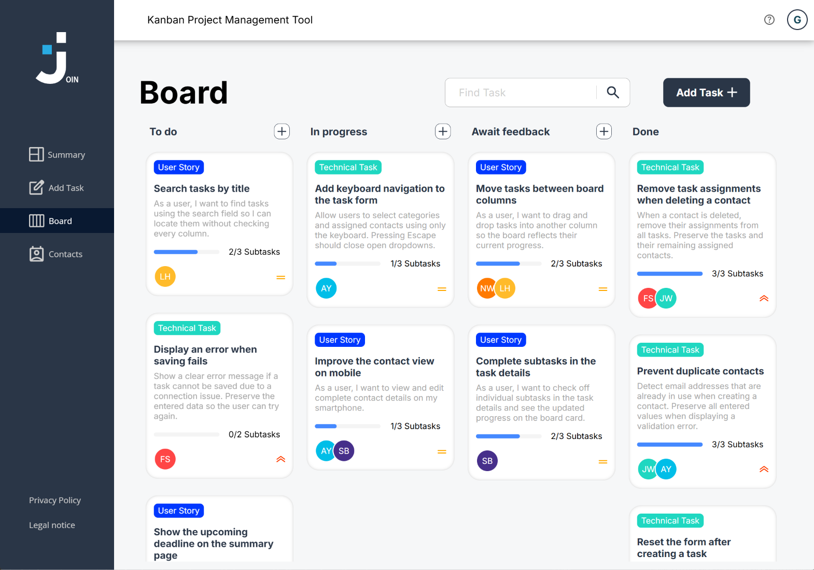
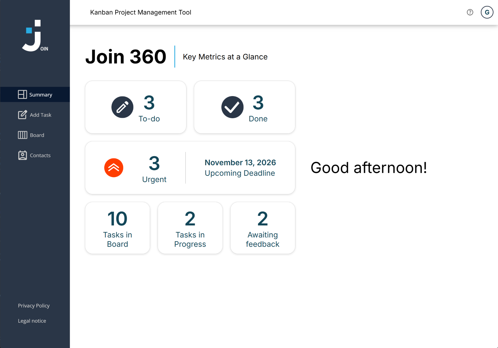
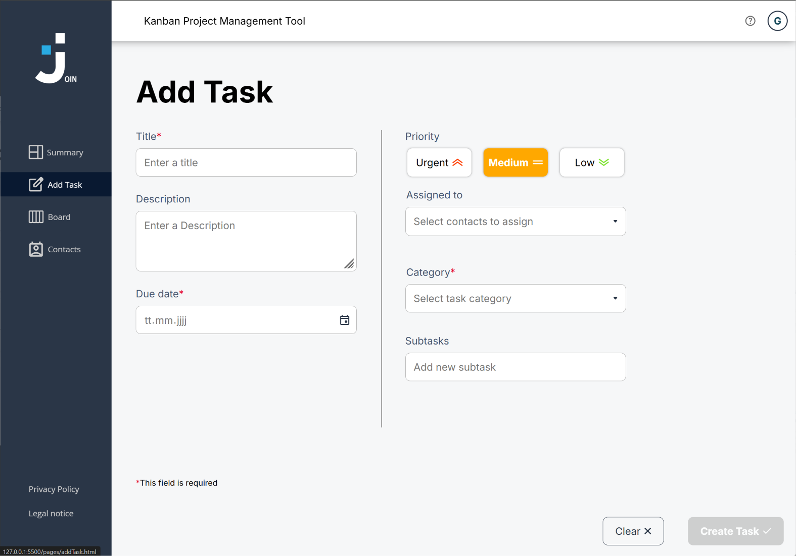
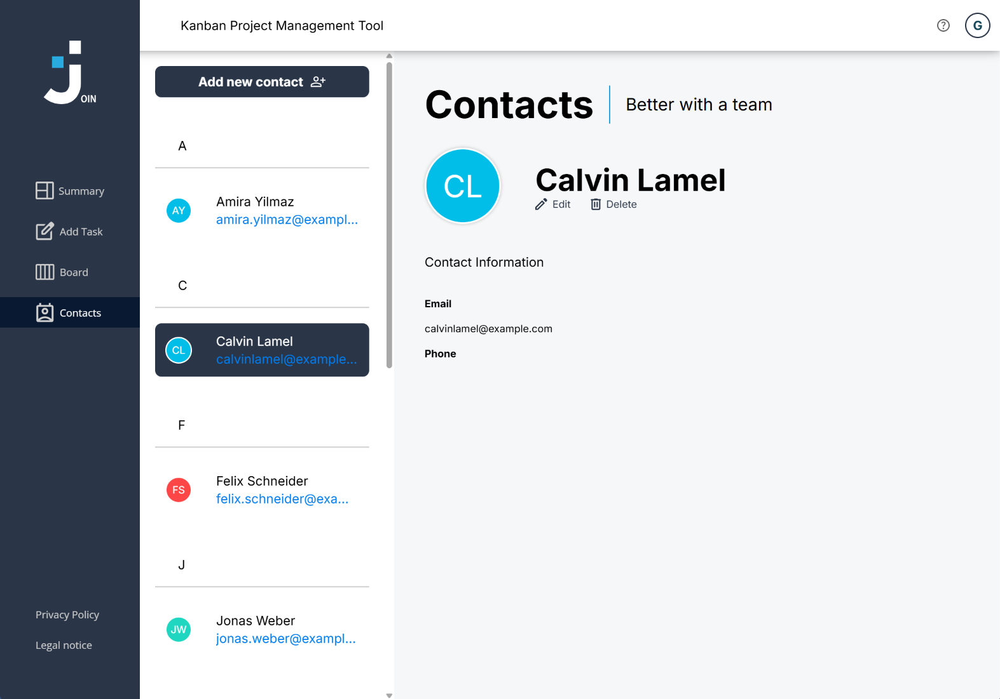

# Join – Kanban Project Management

Join is a web-based Kanban application for organizing tasks and contacts. Users can create tasks, assign them to people, and manage them through different stages of progress.

This team project was developed as part of my web development training and serves as a portfolio project. It demonstrates the practical implementation of an interactive web application using HTML, CSS, JavaScript, and a connected database.

## Project Background

- **Training program / Provider:** Developer Akademie
- **Team:** Calvin Lamel, Sebastian Stock, Norman Domann, Patrick Lorenz
- **Project period:** September - November 2026
- **Live demo:** https://join-3247.developerakademie.net/
- **Design template and project brief:** https://www.figma.com/design/3qlJ22yFozngW2gdOfczMe/Join-Version-1?node-id=0-1&t=k7WXKuA8EyTSN0K1-0

## Preview



<details>
<summary>More Screenshots</summary>

### Summary



### Add Task



### Contacts



</details>

## Features

- **User access:** Registration, login, and guest access to try the application.
- **Summary:** An overview of tasks and their progress.
- **Kanban board:** Organize tasks in the To do, In progress, Await feedback, and Done columns.
- **Task management:** Create, edit, and delete tasks, including descriptions, due dates, priorities, and categories.
- **Assignments and subtasks:** Assign contacts and break tasks down into individual steps.
- **Move tasks:** Change task status using drag-and-drop, keyboard controls, or the move menu.
- **Search:** Search for tasks on the board.
- **Contact management:** Create, view, edit, and delete contacts.
- **Responsive interface:** Layouts for different screen sizes.

## Technologies

| Technology | Purpose |
| --- | --- |
| HTML | Page structure and forms |
| CSS | Layout, responsive design, and animations |
| Vanilla JavaScript | Application logic, DOM manipulation, and form validation |
| Firebase Realtime Database | Storage of users, tasks, and contacts |
| Fetch API | Communication with the Firebase REST API |
| Session Storage | Storage of the current user ID in the browser tab |
| JSDoc | Documentation of functions and data structures |

The project uses no frontend framework. Running it locally requires no package installation or build step.

## Running Locally

### Prerequisites

- A modern browser.
- A local web server, such as the **Live Server** extension for Visual Studio Code.
- An internet connection to access Firebase.
- An accessible Firebase database with appropriate access rules and the required data.

### Steps

1. Clone this repository or download and extract it as a ZIP file.
2. Open the project folder in Visual Studio Code.
3. Launch `index.html` using **Open with Live Server**.
4. Open the application in your browser at the address provided by the local web server.
5. Use **Guest Log in**, or register an account and then log in.

Alternatively, use any other local web server that serves the project folder as a static website. The entry point is `index.html`.

### Firebase Configuration

The database URL is defined by the `DB_BASE_URL` constant in [`script.js`](script.js). The repository already contains a project database URL.

To use your own instance:

1. Set up a Firebase Realtime Database.
2. Replace `DB_BASE_URL` with its database URL, keeping the trailing slash.
3. Configure access rules for the intended read and write operations.
4. Create a guest user at `users/0` for guest access. Its ID is defined by `DB_GUEST_USER_ID`.

A minimal guest user record looks like this:

```json
{
  "users": {
    "0": {
      "name": "Guest",
      "initials": "G",
      "type": "guest"
    }
  }
}
```

The application also uses the `tasks` and `contacts` database paths. Tasks and contacts are shared, including for guest access. Changes to a connected demo database may therefore be visible to other users.

## Project Structure

```text
join/
├── assets/             # Icons and locally hosted fonts
├── pages/              # Pages: Summary, Board, Add Task, Contacts, etc.
├── scripts/            # JavaScript organized by feature and page
│   ├── addTask/         # Task form, assignments, and subtasks
│   ├── board/           # Board, search, dialogs, and task movement
│   ├── contacts/        # Contact management
│   └── signUp/          # Registration and validation
├── styles/             # Shared and page-specific stylesheets
├── index.html          # Entry point with login
├── script.js           # Shared functions and database access
├── style.css           # Global styles
└── README.md           # Project documentation
```

## Learning Objectives

The project focuses on implementing a multi-page web application, processing form data, accessing a database asynchronously, and collaborating as a team using Git.

## Project Status and Limitations

Join was implemented as a team project during my training. Its core features include task management, a Kanban board, contact management, and a task overview.

- **Project status:** Completed in November 2026.
- **Shared demo data:** All users, including guests, use the same board and contacts. Changes may therefore be visible to other users.
- **Internet connection:** The application requires a connection to the Firebase Realtime Database.
- **Login:** The current implementation is intended for learning purposes. Credentials are checked in the frontend, and passwords are stored directly in the database. Please use test data only.

## Credits and Usage Rights

Join was developed as part of the training program at Developer Akademie.
The project brief and the provided design template originate from
Developer Akademie. The application was implemented by the project
team listed above.

- **Inter:** Hosted locally in Regular (400), SemiBold (600), and Bold (700). Font project: [Inter](https://github.com/rsms/inter), released under the [SIL Open Font License 1.1](https://github.com/google/fonts/blob/main/ofl/inter/OFL.txt).
- **Open Sans:** Hosted locally in Regular (400). Font project: [Open Sans](https://github.com/googlefonts/opensans), released under the [SIL Open Font License 1.1](https://github.com/google/fonts/blob/main/ofl/opensans/OFL.txt).
- **Icons, logos, and other design assets:** Taken from the Figma design template provided by Developer Akademie. Inclusion in the template does not constitute a separate license for reuse.

Rights to the provided designs and third-party materials remain with
their respective rights holders.
